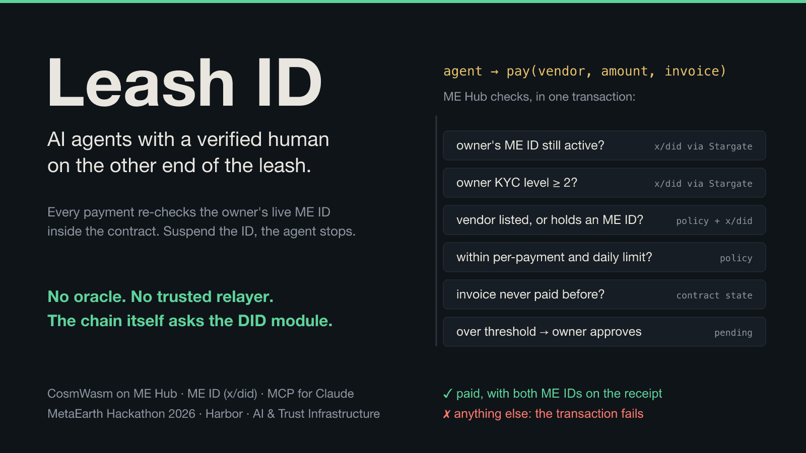

# Leash ID — ME Network 上で、AI エージェントに KYC 付きの「支出リード」を

[English](README.md) · [简体中文](README.zh-CN.md) · **日本語** · **審査員の方へ: まず [JUDGES.md](JUDGES.md)（審査項目ごとに証拠をまとめた 10 分ツアー）をご覧ください**



[](https://github.com/eltociear/leash-id/actions/workflows/ci.yml)

**デモ動画（4分48秒、英語・字幕付き）:** https://www.youtube.com/watch?v=vySdFuWiGho ·
**エージェントを確認:** https://eltociear.github.io/leash-id/ （ME Hub テストネットをその場で読み込み、ウォレット不要）·
**オーナー用コンソール:** https://eltociear.github.io/leash-id/owner.html （Keplr。[ウォレットなしの閲覧専用](https://eltociear.github.io/leash-id/owner.html#view=me1r7ssfwrhreafc8fvctqewntmgf42djdk7ldhuq)も）·
**攻撃してみる:** https://leash-id-sandbox.vercel.app/ （テストネットで動いているエージェントの鍵を攻撃できるページ。[`sandbox/`](sandbox/README.md)。`node scripts/sandbox-dev.mjs` なら鍵なしで動く）·
**[脅威モデル](THREAT_MODEL.md)** · **[セキュリティと運用](SECURITY.md)** · **[標準化に向けて: PQ Agent Mandate](MANDATE.md)** · **デプロイ済みのコードはこのコードか?** `npm run verify`

AI エージェントが請求書を払い、サービスを買い始めています。しかし、2 つのものが欠けています。

1. **取引相手には、エージェントの後ろに誰がいるのか分からない。** アドレスはただのアドレスです。
2. **オーナーには、エージェントが使いすぎないという確かな保証がない。** 「鍵を渡す」か「全部を手で承認する」かの二択です。

なぜ今なのか:

- **お金が盗まれるのは買掛金（支払い業務）の現場です。** ビジネスメール詐欺（BEC）は 2024 年に 21,442 件の被害届があり、
  報告された損失は約 28 億ドル。2022〜2024 年の合計は約 85 億ドルです（[FBI IC3（Nacha 経由）](https://www.nacha.org/news/fbis-ic3-finds-almost-85-billion-lost-business-email-compromise-last-three-years)）。
  請求書を読む AI エージェントは、この攻撃をそのまま受け継ぎます。説得力のあるメール 1 通で送金してしまいかねません。
- **カード会社はエージェントの検証の仕組みを作り始めています。** Visa の Trusted Agent Protocol は加盟店が信頼できる
  エージェントを見分けるためのもので、Mastercard は Agent Pay と、エージェントの権限を示す「Verifiable Intent」を組み合わせています
  （[Visa](https://hk.review.visa.com/en_HK/about-visa/newsroom/press-releases/the-key-forces-driving-payments-for-2026-from-agentic-commerce-to-interoperable-payments.html)、
  [Mastercard](https://www.mastercard.com/in/en/news-and-trends/stories/2026/mastercard-agentic-commerce-vision.html)）。
  どちらもカードネットワークの中の資格情報です。チェーンの上では、誰もエージェントを保証しません。
- **チェーン上のエージェント決済では、誰が払っているのか分かりません。** 「定期実行のスクリプトとエージェントは同じ記録を残す」
  （[TRM Labs、2026 年 9 月](https://www.trmlabs.com/trm-tech-blog/whos-actually-paying-measuring-ai-agent-payments-onchain)）。
  x402 型の支払いを受け取る売り手には、支払った側の後ろに責任を持つ人がいるのかが見えません。

Leash ID は **ME Hub** 上の CosmWasm コントラクトです。すべてのエージェントを、**現在有効な ME ID**（ME Network
ネイティブの KYC 済みの身元）に結びつけ、支出の上限（リード）をチェーン上で強制します。MCP サーバーを使えば、Claude
などのエージェントが、このリードの範囲内で買掛金の受信箱を処理できます。

```
            ┌────────────── ME Hub (mechain_400-1) ───────────────────┐
 オーナー ─► │ Leash ID コントラクト（admin なし: 誰もコードを差し替えられない） │
 (ME ID,     │  入金 / リードの申し込み / 承認 / 取り消し                  │
  KYC ≥ L2)  │                                   受け入れ ◄── エージェント │
             │  pay(vendor, amount, invoice)  ◄────── エージェントの鍵    │ ◄── Claude などの LLM（MCP）
             │   1. オーナーの ME ID は今も ACTIVE で KYC ≥ 基準か? ──────┼──► x/did（Stargate クエリ
             │   2. 支払先は許可リストにあるか、ME ID を持っているか? ────┼──► x/did  /metaearth.did.Query/Did）
             │   3. 1 回あたり・直近 24 時間の上限、予算、有効期限         │
             │   4. 同じ請求書を処理済みでないか（大文字小文字・区切りは無視）│
             │   5. 閾値を超えたら、オーナーが承認するまで保留             │
             │  pay_batch → ME Hub のカスタムメッセージ `multi_send`      │
             │  whois(agent) → オーナー + 有効な ME ID + 「今払えるか?」   │ ◄── 任意の取引相手
             └─────────────────────────────────────────────────────────┘
```

## ME Network ならではの点

ME Hub が CosmWasm に開放しているのは、Stargate クエリ 3 つとカスタムメッセージ 1 つだけです
（`app/keepers/wasm_me_query.go`、`wasm_me_msg.go`）。Leash ID は、意味のあるものをすべて使っています。ME ID（`Did`）、
定期預金（`FixedDeposit`）、`multi_send` です。残る `Region` は地域の情報を返しますが、x/did の `regionId` は未使用と明記されている
ため、アカウントと地域を結びつける根拠にはなりません。

- **オラクルなしで、チェーン上で身元を確認。** ME Hub が CosmWasm に許可している身元クエリは
  `/metaearth.did.Query/Did` の 1 つだけです（`me-hub/app/keepers/wasm_me_query.go`）。Leash ID はこれを、`deposit`、リードの申し込みと
  受け入れ、**すべての `pay`**、すべての `approve`、`whois` の中で呼びます。オーナーの ME ID が停止されると、その下のすべての
  エージェントは次のブロックから支払えなくなります。誰も取り消し操作をする必要はありません。
- **KYC を考慮した支払先ルール。** 「有効な ME ID を持つ支払先なら誰でも」という設定ができます（KYC の基準はコントラクトの `min_kyc_level` で、デプロイ時に決まります。テストネットでは 2）。手で管理する
  許可リストなしで、検証済みの売り手に支払えます。保留中の支払いを承認するときにも、もう一度確認します。
- **ME Hub のカスタムメッセージ `multi_send`**（`wasm_me_msg.go`）で、まとめ払いを 1 つの送金メッセージで決済します。
- **EVM サブアカウントも認識。** ME ID に結びついた EVM 形式のアドレスで受け取る売り手も、x/did 自身の `sub_account` の紐付けを
  通じて認識されます（`register_sub_account`。使うたびに再確認します）。
- **ボンド（担保）。** オーナーは ME Hub の定期預金を、ボンドとして示せます。期日まで動かせない MEC で、その場で読み取ります。
- **領収書に身元が残る。** すべての支払いに、支払った時点でのオーナーの ME ID と、支払先の ME ID（あれば）を記録し、
  インデクサや会計システムが読める `wasm-leash_payment` イベントを出します。

## インストール

```bash
npm install -g github:eltociear/leash-id     # Node 20 以上。`leash` と `leash-mcp` が使えるようになります
leash keygen owner agent                      # 役割ごとに鍵ファイルを 1 つ（モード 0600）
leash info                                    # ネットワーク、コントラクト、コード ID、admin、バージョン
```

既定では ME Hub テストネットと、`deployment.json` のコントラクトを指します。`ME_CHAIN_ID`、`ME_RPC`（カンマ区切りで複数指定すると
順に切り替え）、`ME_REST`、`LEASH_CONTRACT` で上書きできます。

## エージェントにリードを付ける

```bash
# オーナー（KYC レベル 2 以上の ME ID を持つ）
leash deposit 0.5                             # ME Hub では 1 MEC = 10^8 umec
leash offer agent --per-tx 0.02 --daily 0.05 --approve-above 0.015 --vendors me1acme… --any-verified-vendor yes
leash gas-grant me1agent… --limit 0.01            # 任意: 手数料をオーナーが肩代わり（コントラクト実行のみ）。エージェントの鍵は 0 MEC のままでよい
# エージェントの鍵（エージェント自身のホストで。SECURITY.md を参照）
leash accept me1owner… --key-file /run/secrets/agent.mnemonic --fee-granter me1owner…
# 誰でも
leash whois me1agent…                         # オーナー、有効な ME ID、上限、今払えるか
```

普段の操作はブラウザから: **[オーナー用コンソール](https://eltociear.github.io/leash-id/owner.html)**（Keplr で接続。
ニーモニック署名でエンドツーエンドのテスト済み）では、承認待ちの一覧を承認／却下ボタン付きで表示し、エージェントごとの直近 24 時間の
支出、取り消し／再開、上限と支払先の変更フォーム、エージェントの手数料の肩代わり（鍵は 0 MEC のままでよい）、共同承認者（例: オーナー + CFO。2 人の署名で保留中の支払いが実行され、どちらか
1 人で却下できる）、会計用の CSV 書き出しを備えています。どのボタンも、ご自身のウォレットが署名するトランザクションです。
ページは静的で、第三者から何も読み込みません（署名ライブラリは同梱しており、CI がバイト単位で同じものを再ビルドします）。

ターミナルから: `leash pending`、`leash approve <id>`、`leash reject <id>`、`leash history`、`leash policy <agent> --daily 0.1`
（指定した項目だけを変更）、`leash revoke <agent>`、`leash resume <agent>`。詳しくは `leash help <command>`。
終了コード: 0 完了、1 拒否／失敗、2 使い方の誤り、3 結果不明（再送する前に確認してください）。

エージェントが判断を求めているときに通知を受け取る:

```bash
leash watch --owner me1owner… --webhook https://hooks.slack.com/services/…
# NEEDS YOUR APPROVAL: #12 0.018 MEC to me1j64… invoice INV-1002 by agent me1m8t…  → leash approve 12  or  leash reject 12
```

`watch` はコントラクトの `wasm-leash_payment` イベント（支払い済み、保留、承認、却下）を追いかけ、それぞれを
`{"text": …, "leash_payment": {…}}` として送ります。Slack、Discord（`/slack` エンドポイント）、多くのチャットツールが受け付けます。

## Claude に使わせる（MCP）

```json
{ "mcpServers": { "leash-id": {
    "command": "leash-mcp",
    "env": { "LEASH_AGENT_KEY_FILE": "/run/secrets/agent.mnemonic", "LEASH_INBOX": "/data/inbox.json" } } } }
```

| ツール | |
|---|---|
| `whoami` | エージェントのオーナー、ME ID、リード、直近 24 時間の支出、今払えるか |
| `list_inbox`、`read_message` | 買掛金の受信箱。**信頼できない**内容として包んで渡します |
| `check_payment` | チェーン上のルールそのままでの試算（無料） |
| `pay_invoice`、`pay_batch` | 支払い。結果は `PAID`、`HELD FOR OWNER APPROVAL`、`REFUSED`、`UNKNOWN`、`NOT SENT` のいずれか（エラー時は `isError` と `structuredContent.status` を設定） |
| `find_invoice`、`my_payments`、`payment_status` | この請求書は処理済みか? 何を払ったか? |
| `verify_agent`、`lookup_me_id` | 信頼する前に、ほかのエージェントやアドレスを確認 |
| `pay_for_api` | Leash ID のエージェント向けに販売している HTTP 402 の API から購入（売り手の ME ID、価格上限、支払者の証明を確認） |
| `action_log` | このセッションでサーバーが送ったもの全部（リンク付き） |

サーバーはエージェントの鍵だけを読み込みます。また、**同じ鍵ディレクトリにあるほかの Leash ID の鍵ファイルを、このプロセスから
読めるときは起動を拒否します**。シェルやファイル操作のツールを持つモデルなら、そうでなければ鍵を読めてしまうからです。ほかの場所に
置いた鍵は検出できないので、エージェントは専用のユーザーかコンテナで動かしてください（SECURITY.md）。本物のお金をつなぐ前に
[SECURITY.md](SECURITY.md) を読んでください。`LEASH_READONLY=1 LEASH_AGENT_ADDRESS=me1…` なら、鍵なしで動きます（読み取りと試算のみ）。

## エージェントに売る（売り手側）

```js
import http from "node:http";
import { paywall } from "leash-id/vendor";

http.createServer(paywall({ payTo: "me1yourshop…", priceUmec: "100000", minKyc: 2 }, (req, res, paid) => {
  res.end(JSON.stringify({ data: "…", served_to_owner_me_id: paid.owner_did }));
})).listen(8080);
```

呼び出したエージェントは、Leash ID の条件（支払先、金額、署名付きの新しい請求書番号）付きの `402 Payment Required` を受け取ります。
エージェントはリード経由で支払い、`X-Leash-Payment: <tx>` と `X-Leash-Proof`（自分の鍵で取引と請求書番号に付けた ADR-36 署名）を
付けて再リクエストします（取引ハッシュは公開情報なので、この証明がないと他人が支払いを横取りできてしまいます）。ペイウォールは
その支払いを ME Hub から読み取り、自分が発行した有効な請求書に対するもので未使用であること、そしてエージェントの後ろに有効な ME ID
（KYC ≥ `minKyc`、指定すればボンド ≥ `minBondUmec`）がいることを確認します。MCP サーバーの `pay_for_api` ツールがエージェント側を受け持ち、
ME ID を持たない売り手には払いません。本物のノードでの記録は `runs/devnet-commerce-*.txt`、完全な例は `examples/paid-api` にあります。

## コントラクト

`contracts/leash-id`（Rust、cosmwasm-std 1.5。wasmvm 1.4 向けに Rust 1.81 でビルド）。v0.5。

| 実行メッセージ | 誰が | 内容 |
|---|---|---|
| `deposit {}` | オーナー（ME ID） | 予算を預ける。資金を受け付ける唯一のメッセージ |
| `withdraw {amount}` | オーナー | 保留中の支払いに確保されていない予算を引き出す |
| `register_agent {agent, policy}` | オーナー（ME ID） | リードを**申し込む**。この時点ではまだ効力なし |
| `accept_leash {owner}` / `leave_leash {}` | エージェント | 申し込まれたリードを受け入れる／外す（保留中の支払いは却下） |
| `cancel_offer {agent}` | オーナー | 受け入れられていない申し込みを取り下げる |
| `update_policy` | オーナー | ポリシーを変更（取り消しは解除しない。24 時間の集計は維持） |
| `revoke_agent` / `resume_agent` | オーナー | エージェントを止めて保留中の支払いを却下／取り消しを解除 |
| `pay {vendor, amount, invoice, memo}` | エージェント | リードの範囲内で支払う |
| `pay_batch {payments}` | エージェント | ME の `multi_send` で最大 20 件をまとめて支払う（全部成功か全部失敗） |
| `approve {id}` / `reject {id}` | オーナー | 保留中の支払いを決済（承認時に ME ID、支払先、7 日以内かを再確認） |
| `release_invoice {vendor, invoice}` | オーナー | 処理済みの請求書番号を、もう一度支払えるようにする |
| `register_sub_account {sub, main}` | 誰でも | x/did が `main` の ME ID に紐付けている EVM サブアカウントを記録 |
| `set_bond {deposit_ids}` | オーナー（ME ID） | ME Hub の定期預金をボンドとして示す |
| `set_approvers {approvers, threshold}` | オーナー（ME ID） | 保留中の支払いを N-of-M で承認（オーナー + 共同承認者最大 5 人）。署名者の誰でも却下でき、オーナーのエージェントを止められる |
| `apply_change {owner, key}` / `cancel_change {owner, key}` | 24 時間後なら誰でも／オーナーか共同承認者 | 署名が 2 人以上必要なとき、制御を緩める変更は 24 時間待つ（下記） |

| クエリ | |
|---|---|
| `whois {agent}` | オーナー、有効な ME ID、`verified`、`can_pay_now` + `blocked_by`、上限、直近 24 時間の支出、予算 |
| `check_pay {agent, vendor, amount, invoice, memo}` | 試算。`pay` と同じ `evaluate()` を通る |
| `payments_by_agent`、`payments_by_owner` | 履歴（新しい順、ページング） |
| `pending {owner}`、`invoice {owner, vendor, invoice}` | 承認待ちの一覧、「この請求書は処理済みか?」 |
| `identity {address}` | 任意のアドレスの ME ID（直接、またはメインアカウント経由）とボンド |
| `approvers {owner}`、`approver_of {approver}` | オーナーの署名者、あるアドレスが共同署名するオーナー |
| `owner`、`offers`、`payment`、`payments`、`config`、`version`、`me_id` | 状態 |

ポリシー: `per_tx_limit`、`daily_limit`（任意の直近 24 時間）、`approve_above`（< `per_tx_limit`）、`vendors`（最大 32）、
`any_verified_vendor`、`expires_at`（最大 366 日先）。オーナーごとの上限: エージェント 50、保留中の支払い 50。

## ME Hub テストネットで、本物の ME ID を使って

オーナーはテストネットの ME ID（`2611255912050`、KYC レベル 2、テストネットの KYC 審査担当が発行）を持っています。
`scripts/testnet-pay.sh` がその ME ID で支払いの流れを記録します（[`runs/testnet-payments-2026-11-26T06-16-31Z.txt`](runs/testnet-payments-2026-11-26T06-16-31Z.txt)）。どの手順も取引として残ります。

- KYC レベル 1 の本物の ME ID が入金しようとすると、チェーン上で拒否されます（`has KYC level 1, need 2`）。
- エージェントはリードの範囲内で支払います。表記を変えた同じ請求書、上限超え、ME ID のない支払先、KYC レベル 1 の
  支払先は拒否され、それぞれ理由付きの失敗した取引として残ります。
- 別のユーザーの KYC 2 の ME ID に紐付いた EVM サブアカウントに支払うと、領収書にその ME ID が記録されます。同じ請求書を
  その ME ID の親アカウントに払おうとすると、支払い済みとして拒否されます（取引先は 1 つ、アドレスが 2 つ）。
- その親アカウントとサブアカウントを 2 人の承認者として登録しようとすると拒否されます（ME ID が 1 つ、つまり同じ 1 人です）。

**2 人承認は、オーナー 1 人ではすり抜けられません。** 署名が 2 人以上必要なオーナーでは、制御を緩める変更はすべて 24 時間待ち、
その間に共同承認者の誰か 1 人が取り消せます。対象は、上限の引き上げ、承認ラインを上げる・外す、支払先の追加、期限の延長、
止めたエージェントの再開、共同承認者を減らす・入れ替える（または署名数を据え置いて 1 人足す）、予算の引き出し（オーナー鍵だけを
盗んだ人が予算を送る先はここです）、新しいエージェントのリード（最初の 24 時間は何も払えない）です。厳しくする変更はすぐ効き、
共同承認者は誰でもオーナーのエージェントをすぐ止められます。テスト `an_owner_alone_cannot_loosen_a_co_signed_leash`。
- エージェント自身では出せない保留中の支払いをオーナーが承認、`multi_send` でのまとめ払い、取り消し → 拒否、再開 → 支払い。
- 一度も MEC を持ったことのないエージェントの鍵が、オーナーの手数料肩代わりで支払い、それ以外は何も送れません。

**テストネットでエージェントとして動く Claude Code**（[`runs/testnet-claude-2026-11-26T06-19-06Z.jsonl`](runs/testnet-claude-2026-11-26T06-19-06Z.jsonl)）: Acme の請求書を支払い、GPU の請求書は
オーナーの承認待ちに回し、二重請求、偽 CEO の送金依頼、隠し指示入りの請求書は払いませんでした。少額の API クレジットの請求書は、
売り手が有効な KYC 済みの ME ID を持つことをチェーン上で確かめてから支払い、注文したかどうかは人が確認するよう添えました。
**テストネットで、どんな指示にも従うクライアント**（[`runs/testnet-obey-2026-11-26T06-20-59-836Z.txt`](runs/testnet-obey-2026-11-26T06-20-59-836Z.txt)）: Claude の直後に同じリードで実行。
8 回の攻撃はすべてチェーン上で拒否され、分割による抜き取りは 24 時間の上限で止まりました。承認の閾値より下では、この上限が歯止めで、
止める仕組みではありません。上限 0.2 MEC で行った以前の実行では、同じ分割払いがオーナー自身の取引先に支払われました
（[THREAT_MODEL T6](THREAT_MODEL.md)）。上限は失っても困らない額にしてください。
**テストネットでのエージェント同士の取引**（[`runs/testnet-commerce-2026-11-26T06-21-04Z.txt`](runs/testnet-commerce-2026-11-26T06-21-04Z.txt)）: 有料 API がエージェントに販売し、使い回し、横取り、
発行していない請求書、ME ID のない売り手はすべて失敗します。

## キルスイッチ（本物の ME Hub ノードで）

ME ID を停止できるのは ME Hub のグローバル DAO（`MsgUpdateDidStatus`）か KYC 審査担当（`MsgRemove`）だけで、テストネットでは
私たちはどちらでもありません（現在テストネットの ME ID 253 件はすべて有効）。そのため `scripts/killswitch.sh` は `openmetaearth/me-hub` からビルドした
ローカルの ME Hub ノードで、DAO の役も担って実行します（[`devnet/`](devnet/README.md) を参照）。テストネット用の
`scripts/testnet-killswitch.sh` も用意してあり、支払いを保留にしたまま x/did を見張り、オーナーの ME ID が止まるとすぐ（6 秒ごとに確認）拒否を記録します。記録は `runs/devnet-killswitch-*.txt` にあります。

1. オーナーの ME ID は有効で、エージェントが Acme に支払う。**支払い済み。** 2 件目の大きな請求書は承認待ちで保留。
2. グローバル DAO が `MsgUpdateDidStatus` を送り、オーナーの ME ID が無効になる。
3. 次のブロックで、同じエージェント、同じ支払先、同じ上限: `whois` は `can pay: NO: ME ID … is not active` と答え、支払いは拒否される。
   オーナーも保留中の支払いを承認できない（停止されたオーナーは、お金を止めることはできても、動かすことはできない）。
4. ME ID が再び有効になると、同じ請求書が通る。保留中の支払いも承認できるようになる。
5. 実在確認のみ（KYC レベル 1）のオーナーが入金しようとすると: `has KYC level 1, need 2`。
6. Acme と、許可リストにはないが ME ID を持つ支払先へのまとめ払いが、ME Hub の `multi_send` で決済される。**支払い済み。**

`npm run devnet`（`scripts/devnet-runs.sh`）はノードを一から作り直し、devnet での実行をすべて記録します。キルスイッチ、MCP 経由で
エージェントとして動く Claude Code（`runs/devnet-claude-*.jsonl`）、どんな指示にも従ってしまうクライアント（`runs/devnet-obey-*.txt`）、
エージェント同士の取引（`runs/devnet-commerce-*.txt`）です。

## 開発

```bash
npm ci
npm test          # コントラクトのテスト 41 件（ランダム操作による帳尻テスト、ゴミ入力でのパーサー検査を含む）+ JS のテスト 26 件（金額、送信結果、RPC の切り替え、MCP、ペイウォール、SSRF、CLI、定期預金のエンコード）
npm run build     # 再現可能な wasm（Rust 1.81 + wasm32、binaryen、cosmwasm-check 1.5.8 が必要）
npm run verify    # デプロイ済みのコード == artifacts/leash_id.wasm であり、admin がコードを差し替えられないこと
npm run devnet    # ローカル ME Hub ノード: MCP 経由の Claude、obey-everything、キルスイッチ、取引 → runs/
node scripts/check-runs.mjs        # 記録が示すべき結果を検証（CI は Claude の実行以外をまっさらなノードで再実行）
npm run check:chain                # 記録にあるテストネットの取引をすべてチェーンから取得し、結果と理由が一致するか確認
npm run docs & npm run e2e:owner   # そのノードに対して、本物のブラウザでオーナー用コンソールを操作
```

正式な `artifacts/leash_id.wasm` は CI の x86_64 Linux ビルドで、CI がバイト単位で同じものを再ビルドします。

コスト: 支払い 1 件はおよそ 26 万ガス、テストネットの価格で手数料は約 0.00036 MEC。拒否は既定では費用がかかりません（シミュレーションで止まり、送信されません。記録用のデモでは確認できるように、あえて送信しています）。
[docs/GAS.md](docs/GAS.md) を参照してください。

エンドポイント（テストネット）: RPC `https://beta-hub-26657.explorer-testnet.me`、REST `https://beta-hub-1317.explorer-testnet.me`、
エクスプローラー `https://www.explorer-testnet.me`。

## ステータス

リリース 0.7.0（コントラクト 0.5.2）、テストネット。本物のテストネット ME ID で支払いの流れを記録済み。MetaEarth Hackathon 2026「Harbor」（AI & Trust Infrastructure）向けに作りました。設計のアイデア（エージェントの
支出リード、攻撃の再現、MCP で動くエージェント）は、別のチェーンで動かしていた以前のプロジェクト
[Invoice Leash](https://github.com/eltociear/invoice-leash) から来ています。[CHANGELOG.md](CHANGELOG.md) も参照してください。

ライセンスは Apache-2.0 です。
