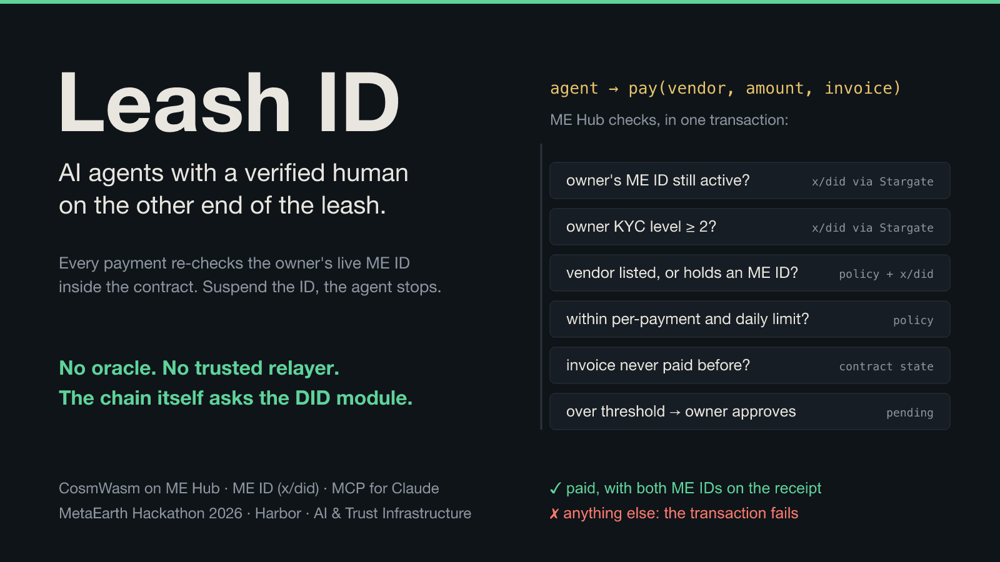

# Leash ID — KYC-backed AI agents on ME Network



[](https://github.com/eltociear/leash-id/actions/workflows/ci.yml)

**Demo video (3:45):** https://www.youtube.com/watch?v=HahwUgfdINE ·
**Check an agent:** https://eltociear.github.io/leash-id/ (reads ME Hub testnet live, no wallet) ·
**Threat model:** [THREAT_MODEL.md](THREAT_MODEL.md) · **Is the deployed code this code?** `npm run verify`

AI agents are starting to pay invoices and buy services. Two things are missing:

1. **Counterparties can't tell who stands behind an agent.** An address is just an address.
2. **Owners have no hard guarantee the agent can't overspend.** It's "hand over your keys" or "approve everything by hand."

Leash ID is a CosmWasm contract on **ME Hub** that ties every agent to a **live ME ID** (ME Network's native KYC identity) and enforces a spending leash on-chain.

```
            ┌────────────── ME Hub (mechain_400-1) ───────────────┐
 owner ───► │ Leash ID contract                                    │
 (ME ID,    │  register_agent / deposit / approve / revoke         │
  KYC ≥ L2) │                                                      │
            │  pay(vendor, amount, invoice)  ◄─────────── agent key │ ◄── Claude / any LLM (MCP)
            │   1. owner's ME ID still ACTIVE and KYC ≥ min? ──────┼──► x/did  (Stargate query
            │   2. vendor allow-listed, or vendor holds an ME ID? ─┼──► x/did   /metaearth.did.Query/Did)
            │   3. per-payment / UTC-daily limits, budget, expiry  │
            │   4. invoice never paid before (owner, vendor, ref)  │
            │   5. over threshold → pending until owner approves   │
            │  pay_batch → ME Hub `multi_send` custom message      │
            │  whois(agent) → owner + live ME ID + limits          │ ◄── any counterparty
            └──────────────────────────────────────────────────────┘
```

## Why this is ME-native

- **On-chain identity checks, no oracle.** ME Hub whitelists one identity query for CosmWasm: `/metaearth.did.Query/Did` (`me-hub/app/keepers/wasm_me_query.go`). Leash ID calls it inside `register_agent`, `deposit`, **every `pay`**, and `whois`. If an owner's ME ID is suspended, every agent under it stops paying in the next block. Nobody has to revoke anything.
- **KYC-aware vendor rules.** A leash can allow "any vendor that holds a live ME ID at KYC level ≥ N", so agents can pay verified merchants without a hand-kept allowlist.
- **ME Hub's custom `multi_send` message** (`wasm_me_msg.go`) settles batched payouts in one bank message.
- **Receipts carry identities.** Every payment stores the owner's ME ID number and the vendor's ME ID (if any) as of the moment it was paid.

## Contract

`contracts/leash-id` (Rust, cosmwasm-std 1.5, built with Rust 1.81 for wasmvm 1.4).

| Execute | Who | What |
|---|---|---|
| `deposit {}` | owner (ME ID required) | escrow the agent budget |
| `withdraw {amount}` | owner | take back unreserved budget |
| `register_agent {agent, policy}` | owner (ME ID required) | leash an agent key |
| `update_policy` / `revoke_agent` | owner | change or cut the leash |
| `pay {vendor, amount, invoice, memo}` | agent | pay within the leash |
| `pay_batch {payments}` | agent | up to 20 payments via ME `multi_send` |
| `approve {id}` / `reject {id}` | owner | settle payments above `approve_above` |

| Query | |
|---|---|
| `whois {agent}` | owner, live ME ID, `verified`, limits, spent today, remaining budget |
| `check_pay {agent, vendor, amount, invoice}` | dry-run; runs the same `evaluate()` as `pay` |
| `owner`, `payment`, `payments`, `config`, `me_id` | read state |

Policy: `per_tx_limit`, `daily_limit` (UTC day), `approve_above`, `vendors`, `any_verified_vendor`, `expires_at`.

## The kill switch, on a real ME Hub node

We can't suspend a testnet ME ID ourselves, so `scripts/killswitch.sh` runs against a local ME Hub node built
from `openmetaearth/me-hub` (see [`devnet/`](devnet/README.md)). Recorded in `runs/devnet-killswitch-*.txt`:

1. The owner's ME ID is active, and the agent pays Acme. **Paid.** A second, larger invoice is held for approval.
2. The global DAO sends `MsgUpdateDidStatus` and the owner's ME ID becomes inactive.
3. In the next block, the same agent, vendor and limits: `whois` shows `verified: false`, and the payment is a
   failed transaction with `ME ID 1000000000101 is not active`. The owner can't approve the held payment either
   (rejecting stays possible: a suspended owner can stop money, never move it).
4. The ME ID is re-activated, and the same invoice goes through. The held payment can now be approved.
5. An owner with only real-person verification (KYC level 1) tries to deposit: `has KYC level 1, need 2`.
6. A batch to Acme plus an unlisted vendor that holds an ME ID settles through ME Hub's `multi_send`. **Paid.**

`npm run devnet` (`scripts/devnet-runs.sh`) rebuilds the node from scratch and records every devnet run:
the kill switch, Claude Code as the agent over MCP (`runs/devnet-claude-*.jsonl`), and the obey-everything
client (`runs/devnet-obey-*.txt`).

Running it on a real node found one bug that the unit tests missed: wasmd rejects empty event attribute values,
so `pay` to a vendor without an ME ID failed. It's fixed, the unit tests now fail on any empty attribute, and the
testnet contract was redeployed (`deployment.json` → `superseded`).

## Run

```bash
npm install
npm test                      # 18 contract unit tests (fake DID module behind the Stargate query; any empty event attribute fails)
npm run build                 # reproducible wasm (local paths remapped) + cosmwasm-check with ME Hub's capabilities
npm run verify                # on-chain checksum of the deployed code == artifacts/leash_id.wasm; CI runs this too
node scripts/keygen.mjs       # testnet-only keys in ~/.config/leash-id/keys.env
node leash.mjs addrs          # balances + ME ID of each role
node leash.mjs deploy         # store + instantiate on mechain_400-1
node leash.mjs deposit 0.5            # 1 MEC = 10^8 umec on ME Hub
node leash.mjs register agent --per-tx 0.02 --daily 0.05 --approve-above 0.015 --vendors vendor
node leash.mjs pay vendor 0.01 INV-001          # as the agent
node leash.mjs whois agent
```

Endpoints (testnet): RPC `https://beta-hub-26657.explorer-testnet.me`, REST `https://beta-hub-1317.explorer-testnet.me`, explorer `https://www.explorer-testnet.me`.

## Status

Built for the MetaEarth Hackathon 2026 "Harbor" (AI & Trust Infrastructure). This is a new codebase. The design ideas (agent spending leashes, attack replays, MCP-driven agents) come from our earlier project [Invoice Leash](https://github.com/eltociear/invoice-leash), which ran on another chain.

Apache-2.0 license.
